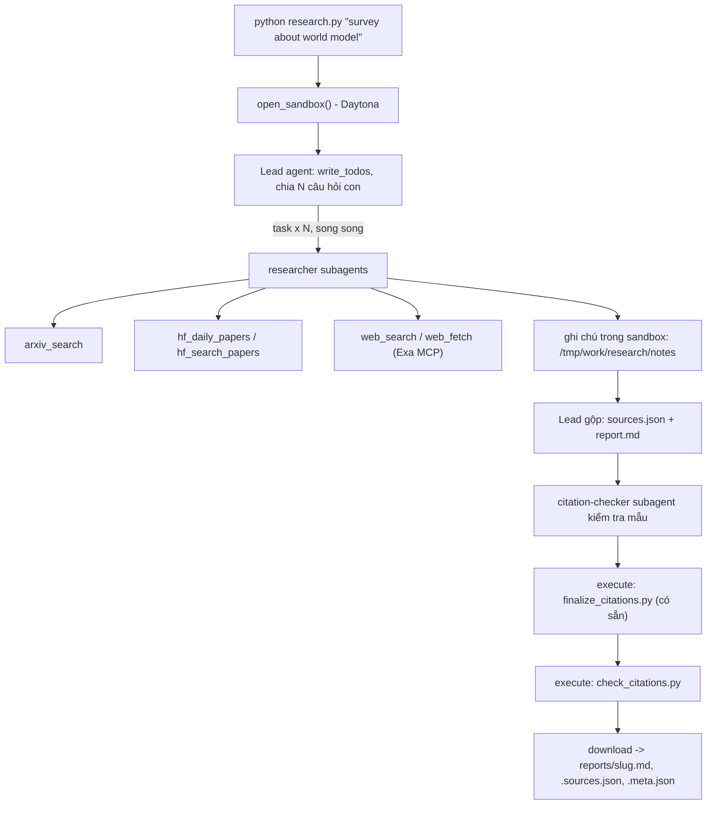

# Deep Research Agent (Deep Agents + Sandbox)

Lab dựng một **hệ thống deep research đa tác tử**: người dùng chỉ cần nhập một chủ đề (ví dụ `survey about world model`), hệ thống tự lập kế hoạch, giao việc cho nhiều subagent, tìm tài liệu trên arXiv, Hugging Face và web, rồi viết một **báo cáo có trích dẫn**.

Hình thức: **bài thực hành cá nhân**. Ngôn ngữ lập trình: Python 3.11 trở lên.

## 1. Mục tiêu học tập

Sau lab, bạn có thể:

1. Dựng agent bằng thư viện Deep Agents (LangChain): công cụ (tool), system prompt, subagent, backend.
2. Dùng **sandbox** (Daytona) làm không gian làm việc và nơi chạy mã cho agent; hiểu vì sao khóa API và công cụ mạng phải nằm ở phía host chứ không nằm trong sandbox.
3. Viết công cụ gọi API ngoài **chịu được giới hạn tốc độ** (retry, backoff, jitter, `Retry-After`).
4. Thiết kế quy trình đa tác tử: lead chia nhỏ câu hỏi, giao cho N researcher chạy song song, tổng hợp và kiểm tra trích dẫn.
5. Tạo báo cáo có thể kiểm chứng: mọi khẳng định có `[n]` trỏ tới một nguồn có thật.

## 2. Hệ thống làm gì



Nguồn dữ liệu:

| Nguồn | Dùng để |
|---|---|
| arXiv API `https://export.arxiv.org/api/query` | Tìm bài theo từ khóa, sắp theo ngày |
| Hugging Face Daily Papers `/api/daily_papers` | Bài đang "trending": upvotes, githubRepo, summary |
| Hugging Face papers search `/api/papers/search?q=` | Tìm bài theo chủ đề |
| Web qua Exa MCP (`web_search_exa`, `web_fetch_exa`) | Blog, survey, trang dự án, nội dung đầy đủ của một URL |

## 3. Cấu trúc thư mục

```
Lab/
├── README.md  GUIDE.md  RUBRIC.md  REPORT_TEMPLATE.md   tài liệu
├── topics.md                 5 chủ đề cần chạy
├── requirements.txt  .env.example  .gitignore
├── model.py                  CÓ SẴN - không sửa: tạo mô hình LLM từ biến môi trường
├── sandbox.py                CÓ SẴN - không sửa: sandbox Daytona (hoặc Docker), upload, download
├── self_check.py             CÓ SẴN - không sửa: tự kiểm tra trước khi nộp (python self_check.py)
├── finalize_citations.py     CÓ SẴN - không sửa: script chạy trong sandbox, tự sinh `## References` và đánh số lại trích dẫn
├── tools.py                  SINH VIÊN CÀI ĐẶT: retry + 5 công cụ nguồn dữ liệu
├── agents.py                 SINH VIÊN CÀI ĐẶT: prompt, subagent, lead agent
├── research.py               SINH VIÊN CÀI ĐẶT: script chính
├── check_citations.py        SINH VIÊN CÀI ĐẶT: kiểm tra trích dẫn, chạy TRONG sandbox
└── reports/                  báo cáo sinh ra (bạn commit vào repo nộp)
```

Bốn tệp `tools.py`, `agents.py`, `research.py`, `check_citations.py` đã được cài đặt. Các tệp có sẵn (`model.py`, `sandbox.py`, `self_check.py`, `finalize_citations.py`) được giữ nguyên.

- Công cụ nguồn chạy trên host, xử lý retry/backoff/jitter, `Retry-After`, giới hạn tốc độ arXiv và lỗi HTTP 200 của Exa. Thông báo trả về che khóa đã cấu hình.
- Lead có `write_todos`, giao ít nhất 3 nhiệm vụ nghiên cứu độc lập, kiểm tra mẫu bằng `citation-checker`, và giới hạn 100 lần gọi mô hình/200 công cụ/12 lần giao việc mỗi lượt invoke. Mỗi researcher giới hạn 40 lần gọi mô hình/60 công cụ; checker giới hạn 20/30. Agent mặc định `general-purpose` cũng được giới hạn 10/20. `recursion_limit=400`.
- Ghi chú và báo cáo nằm trong sandbox. Finalizer và validator chạy tại đó; host tải đúng byte của báo cáo và nguồn, kiểm tra lại rồi lưu cả bộ. Báo cáo thiếu cấu trúc, ít hơn 3 họ nguồn, thiếu giao việc hay trích dẫn lỗi sẽ khiến lần chạy thất bại.
- `tests/test_lab.py` kiểm tra ngoại tuyến retry, nguồn, trích dẫn, metadata, lưu tệp và dọn sandbox khi lỗi; không gọi mô hình trả phí hoặc tạo báo cáo nộp bài.

`evidence.py` lưu danh mục nguồn thực sự trả về từ các công cụ, chia sẻ an toàn giữa các researcher. Middleware chặn lead tạo ghi chú mẫu và chặn researcher ghi nguồn/trích đoạn không có trong dữ liệu đã lấy. Công cụ `retrieved_sources` cung cấp metadata chuẩn để sao chép. `check_evidence.py` được tải lên sandbox cùng validator; nó đối chiếu từng URL, họ nguồn, id, tiêu đề, ngày với danh mục đã lấy và yêu cầu phần thân có ít nhất 1000 từ. Nguồn bịa hoặc gán sai họ khiến lần chạy thất bại, dù số trích dẫn có hợp lệ.

Một lần chạy có pha nghiên cứu và pha viết/kiểm tra để lead không tiếp tục giao việc vô hạn. Host lấy trước một danh mục nhỏ bằng chính các công cụ nguồn; researcher mở rộng và kiểm chứng nó. Lead chọn các cặp `{source, url}` bằng `compile_sources`; công cụ ghi metadata chuẩn vào sandbox, tránh việc mô hình tự tạo URL/id/ngày. `finalize_citations.py` vẫn quyết định danh mục cuối theo các nguồn được báo cáo trích dẫn.

`WorkflowGuard` chỉ mở công cụ phù hợp với pha đang chạy: pha nghiên cứu giao đúng 3 nhiệm vụ và không được ghi báo cáo; pha viết chỉ giao một lượt kiểm tra với ít nhất 5 câu khẳng định và URL. Middleware bổ sung chủ đề, ngày, định dạng và đường dẫn ghi chú riêng vào từng nhiệm vụ. Researcher dùng `save_research_notes` để chọn ít nhất bốn nguồn thật và ghi nhận xét có căn cứ; prompt ưu tiên hai họ nguồn khi có bằng chứng phù hợp, còn báo cáo cuối vẫn bắt buộc ít nhất ba họ. Công cụ sao chép metadata/trích đoạn chính xác rồi ghi tệp trong sandbox. Danh mục nguồn được xen kẽ theo họ để không che mất nguồn web/nền tảng. Những dữ liệu thực đã lấy trong 24 giờ có thể được dùng lại khi sửa một lượt chạy lỗi.

Sau một lượt agent, host kiểm tra cả cấu trúc, họ nguồn và giao việc. Nếu chưa đạt, host gửi lỗi cụ thể về cùng hội thoại để lead sửa ngay trong sandbox, tối đa 2 lượt sửa. Giới hạn middleware áp dụng cho từng lượt invoke; bộ đếm dùng chung chặn toàn đội ở 100 lần gọi mô hình và 200 công cụ trong cả lần chạy, kể cả các lượt sửa. Sau 15 phút, callback từ chối lần gọi mới; yêu cầu đang chạy không bị ngắt ngay. Một yêu cầu công cụ với cùng đối số lỗi ba lần sẽ chặn các lần gọi mới; thành công xóa bộ đếm lỗi của yêu cầu đó. Tiến độ in bộ đếm và lý do dừng. Dữ liệu nguồn và chẩn đoán đã che khóa được lưu ở `.runs/` (bỏ qua bởi git) để kiểm chứng; chỉ báo cáo đạt mới vào `reports/`.

Các yêu cầu arXiv được tuần tự hóa với khoảng cách ít nhất ba giây và một kết nối tại một thời điểm. Mỗi thao tác mạng có timeout 20 giây (kết nối 10 giây), tối đa ba lần thử với backoff/jitter. Khi hết lượt thử vì lỗi tạm thời, công cụ ngừng gọi arXiv trong 120 giây và đề nghị dùng dữ liệu đã lấy hoặc HF/web; nguồn thay thế giữ đúng họ nguồn thực tế. Các công cụ mạng chạy trên host, nên việc sandbox chặn internet không ảnh hưởng đến truy vấn arXiv.

`normalize_citations.py` chạy trong sandbox ngay trước finalizer qua `CitationSandbox`. Nó chỉ đổi trích dẫn theo tiêu đề/năm hoặc liên kết tới URL có trong danh mục nguồn thành `[n]`; nguồn không rõ, năm sai hay tiêu đề trùng gây lỗi. Nó không thêm nguồn hoặc viết lại khẳng định. Mức 1000 từ trong `check_evidence.py` là kiểm tra chất lượng bổ sung của triển khai này, không phải số từ tối thiểu do rubric quy định.

`WorkflowGuard` giữ riêng các tin nhắn lead để tính metadata ngay cả khi thư viện tóm tắt lịch sử hội thoại. `.runs/<slug>/live-events.jsonl` ghi tiến độ công cụ trong lúc chạy; `trace.json` ghi chẩn đoán khi lượt chạy kết thúc. Những tệp này được che khóa và bỏ qua bởi git.

## 4. Cài đặt

```bash
python3 -m venv .venv && source .venv/bin/activate      # Python 3.11+
pip install -r requirements.txt
cp .env.example .env                                     # rồi điền khóa CỦA BẠN
```

Trên Windows PowerShell, dùng:

```powershell
python -m venv .venv
.\.venv\Scripts\python.exe -m pip install -r requirements.txt
Copy-Item .env.example .env  # chỉ chạy khi chưa có .env
# Điền LAB_MODEL, khóa LLM và DAYTONA_API_KEY trong .env bằng trình soạn thảo.
.\.venv\Scripts\python.exe -m unittest discover -s tests -v
.\.venv\Scripts\python.exe -u tools.py
.\.venv\Scripts\python.exe -u research.py "survey about world model"
```

Nếu dùng môi trường ảo đã kích hoạt, có thể dùng `python` thay cho đường dẫn đầy đủ. `.env` và `.venv/` được bỏ qua bởi git.

Nếu Daytona báo tổ chức chưa có default region, mở dashboard và đặt default region trong cài đặt tổ chức. Có thể thêm `DAYTONA_TARGET=us` (hoặc `eu`) vào `.env` để chọn region cho lần chạy, nhưng tài khoản mới vẫn có thể yêu cầu hoàn tất thiết lập default region trước; xem [cài đặt tổ chức Daytona](https://www.daytona.io/docs/en/organizations/).

Bạn cần ba loại khóa (điền vào `.env`, **không bao giờ commit** `.env`):

| Khóa | Lấy ở đâu | Ghi chú |
|---|---|---|
| LLM (`LAB_MODEL` + khóa nhà cung cấp) | Nhà cung cấp bạn chọn (OpenAI, Anthropic, Google, OpenRouter, Ollama...) | Mô hình **phải hỗ trợ tool calling**. Chép tên mô hình từ tài liệu của nhà cung cấp. |
| `DAYTONA_API_KEY` | https://app.daytona.io | Kiểm tra gói miễn phí / credit hiện hành. Không có tài khoản hoặc hết credit: đặt `SANDBOX=docker` để chạy sandbox trong container Docker cục bộ (xem `.env.example`). |
| `EXA_API_KEY` (khuyến nghị) | https://dashboard.exa.ai/api-keys | Có thể chạy không khóa, nhưng bản miễn phí của MCP bị giới hạn tốc độ rất nhanh. |

## 5. Làm bài

Làm theo thứ tự (chi tiết trong `GUIDE.md`):

1. `check_citations.py`: khởi động nhẹ, thuần Python.
2. `tools.py`: viết `with_retry` và 5 công cụ. Thử riêng từng công cụ: `python tools.py`.
3. `agents.py`: viết prompt, subagent và lead agent.
4. `research.py`: ghép tất cả; chạy một chủ đề:

```bash
python research.py "survey about world model"
```

Kết quả nằm ở `reports/survey-about-world-model.md` cùng `.sources.json` và `.meta.json`.

## 6. Chủ đề và nộp bài

- Chạy đủ **5 chủ đề** trong [`topics.md`](topics.md), mỗi chủ đề một lần.
- Có thể chạy tuần tự cả 5 bằng `python research.py --all` (PowerShell: `.\.venv\Scripts\python.exe -u research.py --all`). Lệnh dừng ở chủ đề đầu tiên thất bại để bạn sửa cấu hình hoặc quy trình trước khi tiếp tục.
- Commit mã nguồn và toàn bộ `reports/`, đẩy lên một **public repo** GitHub và nộp link.
- Kiểm tra trước khi nộp: chạy **`python self_check.py`** (không tốn token): nó kiểm tra đủ 5 báo cáo, `meta.json`, trích dẫn bằng `check_citations.py` của bạn, và không có `.env`/khóa nào trong git.
- Cách chấm: xem [`RUBRIC.md`](RUBRIC.md).

Đọc kết quả trong `reports/`: `<slug>.md` là báo cáo tiếng Anh có trích dẫn; `<slug>.sources.json` là danh mục nguồn; `<slug>.meta.json` chứa chủ đề, mô hình, thời gian, số lần giao việc, số công cụ, số nguồn và họ nguồn. `tokens` chỉ là số đo từ tin nhắn lead, không bao gồm token của subagent. Không chỉnh tay `.md` hoặc `.sources.json`: sửa mã/prompt rồi chạy lại.

Kiểm thử ngoại tuyến và kiểm tra nộp bài là hai bước khác nhau:

```bash
python -m unittest discover -s tests -v
python self_check.py
```

Test ngoại tuyến có thể đạt ngay cả khi chưa cấu hình khóa. `self_check.py` chỉ báo sẵn sàng sau khi đủ 5 báo cáo thật cùng metadata và nguồn hợp lệ. Không tạo báo cáo giả để vượt qua bước này.

Nếu tiến trình bị cưỡng chế dừng, có thể dùng `python research.py --list-sandboxes` để tìm sandbox còn chạy. `python research.py --cleanup-sandbox <id>` chỉ xóa khi sandbox chứa đúng bản validator của bài lab; không dùng lệnh này cho sandbox của công việc khác.

## 7. Thời gian, chi phí và an toàn

- Dùng một mô hình **rẻ nhưng hỗ trợ tool calling**, và **đặt giới hạn** (số lần gọi mô hình/công cụ cho lead và subagent, `recursion_limit`): một prompt hỏng có thể khiến agent lặp rất lâu. Đây là hạng mục 2.5 của `RUBRIC.md`.
- Kết quả có tính ngẫu nhiên: cùng một mã có thể cho báo cáo hợp lệ ở lần này và trích dẫn lỗi ở lần sau. Hãy sửa **prompt và mã**, không sửa tay báo cáo.

- Mỗi lần chạy tốn token LLM và thời gian sandbox. `tokens` trong `meta.json` chỉ đếm tin nhắn của lead, chưa gồm subagent, nên chi phí thật cao hơn. `open_sandbox()` luôn dừng và xóa sandbox khi kết thúc, kể cả khi lỗi. Đừng bỏ qua nó.
- **Không đưa bí mật vào sandbox.** Sandbox không ngăn được prompt injection hay việc đẩy dữ liệu ra mạng; một trang web độc hại có thể khiến agent chạy lệnh bên trong sandbox. Vì vậy mọi công cụ gọi mạng và mọi khóa ở lại phía host.
- Nội dung lấy từ web là **dữ liệu không đáng tin**: agent không được làm theo chỉ dẫn nằm trong đó.
